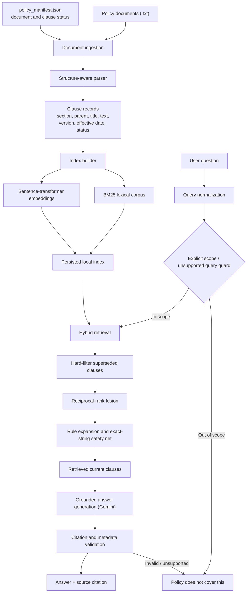

# Architecture — Trade Policy Question Answering Assistant

## 1. Purpose

The assistant answers commercial questions using trade-policy documents only. It returns a supported answer with its source section, document version, and effective date, or clearly says: **“The policy does not cover this.”**

The retrieval unit is a numbered clause/subclause. This preserves policy structure and avoids splitting a rule from the conditions that qualify it.

## 2. End-to-end architecture



## 3. Main components

### A. Document ingestion and metadata

**Implementation:** `src/indexer.py`

- Reads `.txt` policy files from the configured policy directory.
- Reads `data/policy_manifest.json` when present.
- Accepts document-level status (`current` or `superseded`) and optional clause-level status overrides.
- Parses each document and retains its source filename.
- Writes clause records and retrieval artifacts to the local `index/` directory.

Each clause record carries its section/clause identifier, parent section (where applicable), title, text, document version, effective date, current/superseded status, and source filename.

**Scale-up requirement:** For a larger corpus, every document/version should have an explicitly reviewed identity, market, channel scope, effective date, and supersession relationship in the ingestion manifest. A newly uploaded file must not automatically become current merely because it is newer or was ingested last.

### B. Structure-aware parsing

**Implementation:** `src/parser.py`

- Recognizes numbered `SECTION N` headings and numbered subclauses such as `3.1`.
- Keeps a clause/subclause together as an atomic retrieval record.
- Records the parent section for subclauses.
- Preserves Section 3's channel/discount table as one clause.
- For this sample only, separates the historical Version 1.0 Modern Trade value (15%) from the active Section 3.1 text and marks that historical record as superseded.

Section 3 gives the channel limits while Section 3.1 explains the Modern Trade revision. A Modern Trade discount answer needs both pieces of context.

**Known limitation:** Historical-value extraction is tailored to the exact wording in this sample policy. A general multi-document system should represent amendments and supersession as explicit, reviewed metadata rather than rely on a sample-specific text pattern.

### C. Index construction

**Implementation:** `src/indexer.py`

Two complementary representations are built for each clause:

1. **BM25 lexical index** — supports exact terms, section numbers, abbreviations, percentages, and monetary strings.
2. **Sentence-transformer embeddings** — supports semantically similar questions and paraphrases.

The embedding model is `sentence-transformers/all-MiniLM-L6-v2`; embeddings are normalized and stored locally. BM25 token data and clause metadata are also persisted locally.

The two indexes are used together because neither is sufficient alone for the requirements in the brief.

### D. Query processing and retrieval

**Implementation:** `src/normalization.py` and `src/retrieval.py`

The retrieval path is:

1. Normalize the user's question.
2. Apply the explicit out-of-scope phrase guard and a special guard for monetary “credit limit” questions, which the sample policy does not define.
3. Score clauses using BM25 and embedding similarity.
4. Filter to `current` clauses before ranking results for generation.
5. Merge the two rankings using reciprocal-rank fusion (RRF), rather than directly adding raw scores from different scoring systems.
6. Apply targeted rule expansion for Modern Trade discount questions so Sections 3 and 3.1 are both included.
7. Apply a deterministic lexical safety net for selected exact-value and abbreviation queries.
8. Return only current clauses to the answer-generation step.

**Why status is a hard filter:** Whether a clause is current is a document-governance fact, not a semantic-similarity judgment. Superseded records can remain stored for audit, but must not be eligible evidence for an ordinary current-policy answer.

**Known limitation:** The current scope guard and exact-string safety net are small, sample-specific rules. They are not a complete general-purpose policy classifier or entity/value extraction system.

### E. Answer generation and validation

**Implementation:** `src/generation.py`

- If the query is flagged as out of scope, or retrieval returns no clauses, the system returns the refusal text without calling the language model.
- Otherwise, only retrieved current clauses are supplied to Gemini.
- The prompt instructs the model to use no outside knowledge, state conditions, and cite the relevant section(s).
- The application checks that the answer contains a source section and that every cited section is among the retrieved current clauses.
- For Modern Trade discount questions, it additionally requires citations to both Sections 3 and 3.1.
- The application removes the model-written source line and appends a canonical citation using version and effective-date metadata from the retrieved clause records.

Citation format:

`Source: Section X.Y | Version V | Effective date DATE`

For a rule that depends on both the general section and its subclause, the citation names both.

**Important limitation:** This validation checks citation presence and whether cited sections were retrieved. It does not independently prove that every factual statement in the generated prose is entailed by the cited text. That should be strengthened with claim-level checks and adversarial evaluation before relying on the system for operational policy decisions.

## 4. Key design decisions and rejected alternatives

| Decision | Reason |
|---|---|
| Clause-level retrieval | Preserves numbered policy structure and parent/subclause relationships. |
| BM25 + embeddings | Covers both exact strings and paraphrased questions. |
| Reciprocal-rank fusion | Combines rankings without treating BM25 and cosine scores as directly comparable. |
| Hard current-status filter | Prevents similarity ranking from resurfacing superseded policy values. |
| Explicit parent/child expansion | Ensures the general rule and its narrowing subclause are considered together for the known Modern Trade case. |
| Grounded generation with refusal | Prevents an intentional general-knowledge fallback when the policy does not provide an answer. |
| Local command-line workflow | Matches the brief; no UI, authentication, deployment, or cloud infrastructure is required. |

Rejected for this scope:

- **Vector-only retrieval:** can miss exact amounts, abbreviations, and section identifiers.
- **BM25-only retrieval:** can be brittle when users paraphrase policy language.
- **Arbitrary fixed-size chunks:** can detach a subclause from its governing rule.
- **Putting the entire document in every prompt:** acceptable for one short document, but inefficient and difficult to govern across hundreds of documents and versions.
- **Fine-tuning and deployment:** explicitly outside the requested scope.

## 5. Running the current implementation

Run these commands from the project root. On Windows PowerShell, activation is optional; the direct interpreter form avoids PowerShell execution-policy restrictions.

```powershell
# Build or rebuild the local index
.venv\Scripts\python.exe ask.py --index

# Ask questions
.venv\Scripts\python.exe ask.py "What is the maximum discount for Modern Trade?"
.venv\Scripts\python.exe ask.py "Who approves a scheme above Rs 5 lakh?"
.venv\Scripts\python.exe ask.py "What is the employee leave policy?"
```

The first index build downloads the sentence-transformer model. Answerable questions require `GEMINI_API_KEY` to be configured. The explicit HR scope refusal and empty-retrieval refusal do not require a model call.

## 6. Current sample versus intended larger-corpus design

The current project is a sample implementation over the supplied policy format. It demonstrates clause parsing, hybrid retrieval, current-status filtering, a targeted nested-rule expansion, refusal handling, and citation metadata handling.

It is **not yet a complete production-ready 200-document governance system**. Before scaling, the main engineering work is:

1. Define and validate a formal document/version manifest, including market, channel, effective dates, and supersession links.
2. Replace sample-specific historical-value parsing and query guards with metadata-driven rules.
3. Generalize parent/child expansion across policy structures instead of handling only the known Modern Trade case.
4. Strengthen scope detection and exact-value retrieval beyond the current hand-selected patterns.
5. Add claim-level answer grounding and adversarial tests for unsupported answers, conflicting versions, and paraphrases.
6. Measure retrieval recall, answer correctness, citation correctness, refusal accuracy, and superseded-value leakage on a reviewed evaluation set.

The design direction is intended to scale to the brief's larger corpus; the current implementation should be presented honestly as the first working slice of that architecture.
